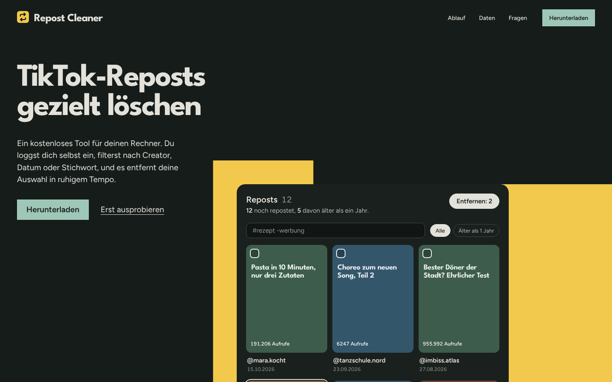
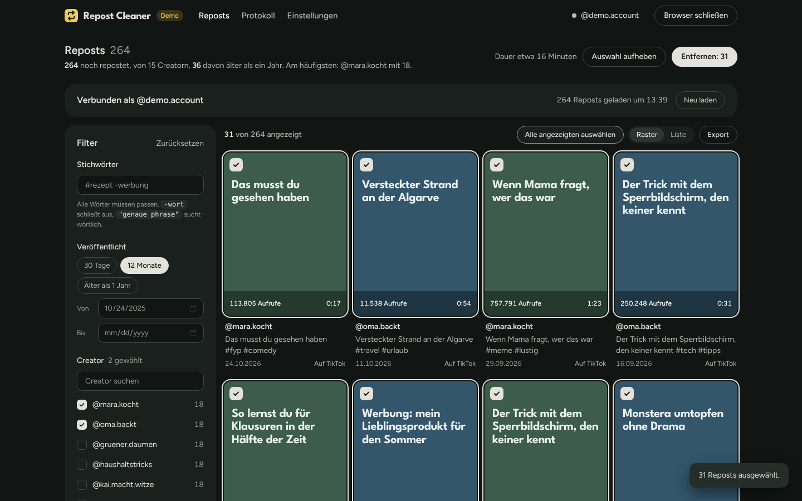
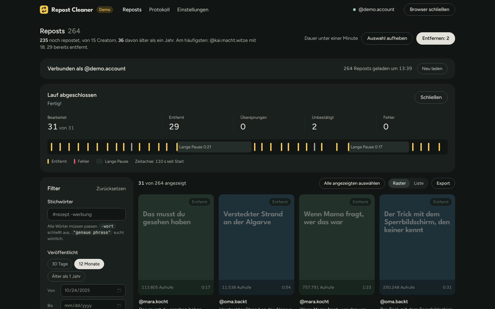

# Repost Cleaner

Zwei unabhängige Teile:

| Ordner | Was | Läuft wo |
|---|---|---|
| [`tool/`](tool/) | Lokales Tool zum Filtern und Entfernen der eigenen TikTok-Reposts (Node.js, Express, Playwright, Weboberfläche) | auf dem Rechner der Nutzer:innen, nur `127.0.0.1` |
| [`landing/`](landing/) | Landingpage für **tiktok.hyprnode.de** (Node.js/Express, statisch, kein Tracking) | auf deinem Server |

Die Landingpage hat **keine** Login-Felder, Formulare oder TikTok-Logik – sie erklärt das Tool und liefert das ZIP aus.

## Tool lokal starten

```bash
cd tool
npm install
npm run demo     # Oberfläche mit Beispieldaten testen
npm start        # echter Betrieb
```

Details: [`tool/README.md`](tool/README.md)

## Landingpage

```bash
cd landing
npm install
npm run build:download   # packt ../tool → downloads/repost-cleaner-v<version>.zip (+ SHA-256)
npm start                # http://127.0.0.1:3000
```

Umgebungsvariablen: `PORT` (3000), `HOST` (127.0.0.1), `NODE_ENV=production` (aktiviert HSTS + upgrade-insecure-requests), `DOWNLOAD_URL` (optional: externer Download, z. B. GitHub Release).

### Deployment auf tiktok.hyprnode.de

1. DNS: `A`/`AAAA`-Record `tiktok.hyprnode.de` → dein Server
2. Code nach `/var/www/repost-cleaner` kopieren, dann `cd landing && npm ci --omit=dev && npm run build:download`
   (für `build:download` einmalig `npm install` inkl. devDependencies, oder ZIP lokal bauen und `downloads/` mit hochladen)
3. systemd: `landing/deploy/repost-cleaner-landing.service` nach `/etc/systemd/system/` kopieren, `systemctl enable --now repost-cleaner-landing`
4. nginx: `landing/deploy/nginx-tiktok.hyprnode.de.conf` einbinden, `certbot --nginx -d tiktok.hyprnode.de`
5. Alternativ Docker: `docker build -t repost-landing landing && docker run -p 127.0.0.1:3000:3000 repost-landing`

**Vor dem Livegang:** Platzhalter in `landing/public/impressum.html` und `landing/public/datenschutz.html` (hervorgehoben) ausfüllen.

Schriften (League Spartan, Figtree, beide SIL Open Font License) werden selbst gehostet – keine Verbindung zu Google Fonts (DSGVO).

## Design

Beide Oberflächen wurden mit dem [taste-skill](https://github.com/Leonxlnx/taste-skill) gestaltet und geprüft
(`lint.mjs` + `inspect.mjs`, 0 FAIL):

- **Landingpage** – Richtung „The product performs“: Statt Feature-Kacheln zeigt die Seite bedienbare Stücke des Tools
  (Filter und Auswahl im Hero, Pausen-Regler mit live berechneter Laufdauer, Filter-Panel mit Randnotizen).
  Bilder sind echte Screenshots und eine echte Aufnahme des Tools im Demo-Modus (`landing/public/assets/`).
- **Tool** – Stil „True-black flat“ mit der Palette der Landingpage: Ebenen nur über Helligkeit, Farbe nur auf Daten.
  Das Repost-Gelb markiert, was gerade entfernt wird; die Zeitleiste eines Laufs zeigt jede Aktion und jede lange Pause.

Alle Beispiel-Accounts in Demo-Modus und Landingpage (`@mara.kocht`, `@oma.backt` …) sind erfunden.




